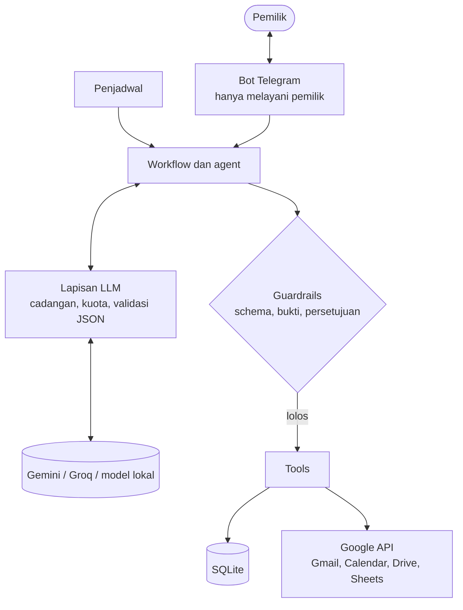

# Agent Asisten Cari Kerja

Agent pribadi berbasis LLM yang membantu proses mencari kerja langsung di aplikasi yang sudah dipakai
sehari-hari. Agent menilai lowongan terhadap profil, menyiapkan CV dan cover letter yang setiap klaimnya bisa
ditelusuri ke bukti, serta mengelola email rekruter dan jadwal interview lewat Telegram, Gmail,
Google Calendar, Drive, dan Sheets.

Prinsip utamanya: **LLM hanya mengusulkan, kode yang memutuskan.** Validasi, perhitungan, dan setiap tindakan
yang keluar ke pihak lain dijaga oleh kode. Tidak ada email atau lamaran yang terkirim tanpa persetujuan pemilik.

> **Status:** Tahap 0 selesai. Fondasinya sudah berjalan: bot Telegram khusus pemilik, klien LLM dengan
> penyedia cadangan dan pengendali kuota, koneksi Google dengan izin sempit, serta profil berbasis bukti.

## Roadmap

| Tahap | Isi | Status |
| --- | --- | --- |
| 0 | Fondasi: bot Telegram, klien LLM, koneksi Google, profil dan database | Selesai |
| 1 | Penilaian lowongan: ekstraksi requirement, pencocokan dengan profil, skor, tracker Sheets | Berikutnya |
| 2 | Paket lamaran: CV dan cover letter yang divalidasi terhadap bukti di profil | Direncanakan |
| 3 | Persetujuan lewat Telegram, deteksi email rekruter, jadwal interview otomatis | Direncanakan |
| 4 | Persiapan dan simulasi interview, follow-up, laporan strategi mingguan | Direncanakan |
| 5 | Perintah bebas lewat loop agent, pengisian form lamaran | Direncanakan |
| 6 | Berjalan 24 jam di VM gratis | Direncanakan |

## Arsitektur



Diagram di atas adalah rancangan lengkapnya. Yang sudah ada di Tahap 0: bot Telegram, lapisan LLM, database,
dan koneksi Google. Penjadwal, workflow, dan tools dibangun mulai Tahap 1.

Pembagian kerja antara LLM dan kode:

- **LLM** dipakai hanya untuk langkah yang butuh memahami atau menulis bahasa, misalnya mengubah teks lowongan
  menjadi daftar requirement terstruktur.
- **Kode** mengerjakan semua yang harus pasti: menghitung skor, membuat event kalender, menulis ke Sheets,
  memeriksa kuota, dan memeriksa persetujuan.
- Output LLM selalu divalidasi terhadap schema sebelum dipakai. Output yang tidak valid ditolak.

## Guardrail yang sudah diterapkan

| Aturan | Cara penegakan | Lokasi |
| --- | --- | --- |
| Bot hanya melayani pemiliknya | Pesan dari `chat_id` lain dihentikan sebelum mencapai handler mana pun | `app/integrasi/telegram_bot.py` |
| Kuota LLM tidak terbuang | Jeda per menit, hitungan 24 jam, berhenti di 90%, tanpa coba ulang tersembunyi | `app/llm/client.py` |
| Tetap jalan saat penyedia gagal | Otomatis pindah: utama, cadangan, lalu penyedia ketiga | `app/llm/client.py` |
| Output LLM harus sesuai format | Validasi Pydantic, satu kali coba ulang dengan pesan kesalahan | `app/llm/client.py`, `app/llm/schemas.py` |
| Tidak ada skill tanpa bukti | Profil divalidasi sebelum masuk database | `app/db/profil.py` |
| Izin Google sesempit mungkin | Hanya kalender dan file buatan agent; jam sibuk tanpa isi event | `app/integrasi/google_api.py` |
| Token Google tidak tersimpan polos | Dienkripsi dengan Fernet, kuncinya terpisah di `.env` | `app/integrasi/google_api.py` |

Setiap aturan di atas diuji oleh unit test di `tests/`, yang berjalan tanpa internet.

## Teknologi

Python 3.11+, [python-telegram-bot](https://python-telegram-bot.org/), [LiteLLM](https://docs.litellm.ai/),
Pydantic, SQLite, Google API Python Client, cryptography (Fernet), pytest, ruff.

Tidak memakai framework agent. Workflow ditulis langsung supaya setiap aturan terlihat dan bisa diuji.

## Struktur folder

```
app/
  main.py                     menjalankan bot Telegram
  config.py                   membaca konfigurasi dari .env
  db/schema.sql               definisi semua tabel
  db/repo.py                  akses database, log LLM, hitungan kuota
  db/profil.py                validasi dan pemuatan profil
  llm/client.py               pemanggilan LLM: cadangan, batas per menit, kuota, validasi JSON
  llm/schemas.py              schema output LLM
  prompts/                    prompt per tugas, diberi versi
  integrasi/telegram_bot.py   bot yang hanya melayani pemilik
  integrasi/google_api.py     Gmail, Calendar, Drive, Sheets
  tools/ workflows/ agent/    diisi mulai Tahap 1
scripts/                      alat setup dan uji koneksi (dijalankan manual)
tests/                        unit test tanpa internet
data_dummy/                   profil dan lowongan contoh (fiktif)
eval/datasets/                dataset evaluasi, diisi mulai Tahap 1
```

Folder `data/` (database dan profil asli) dan `secrets/` (file OAuth dan token) dibuat saat dijalankan dan
tidak pernah masuk repo.

## Menjalankan

```powershell
git clone https://github.com/ReymonthaTarigan/AI-Agent-Pencari-Kerja.git
cd AI-Agent-Pencari-Kerja
python -m venv .venv
.venv\Scripts\Activate.ps1          # macOS/Linux: source .venv/bin/activate
pip install -r requirements-dev.txt
copy .env.example .env              # macOS/Linux: cp .env.example .env
python -m scripts.init_db           # memuat profil contoh ke database
python -m pytest
```

### Konfigurasi

Isi `.env` (tanpa tanda kutip), lalu ikuti urutan ini:

1. **Kunci enkripsi**: `python -m scripts.buat_kunci`, salin hasilnya ke `TOKEN_KEY`.
2. **Telegram**: buat bot lewat @BotFather dan isi `TELEGRAM_BOT_TOKEN`. Jalankan `python -m app.main`, kirim
   `/whoami` ke bot, isi angkanya ke `TELEGRAM_OWNER_CHAT_ID`, lalu jalankan ulang bot dan kirim `/start`.
3. **LLM**: isi `GEMINI_API_KEY` (Google AI Studio) dan `GROQ_API_KEY` (Groq console). Pilih model dari
   `python -m scripts.daftar_model`, lalu uji dengan `python -m scripts.uji_koneksi_llm`.
4. **Google**: di Google Cloud Console buat project, aktifkan Gmail, Calendar, Drive, Docs, dan Sheets API,
   tambahkan akunmu sebagai test user di Google Auth Platform, lalu buat OAuth client tipe *Desktop app*.
   Simpan file JSON-nya sebagai `secrets/client_secret.json` dan jalankan
   `python -m scripts.uji_koneksi_google --login`. Centang semua izin saat login.
5. **Periksa**: `python -m scripts.cek_tahap0` harus menampilkan "Gerbang Tahap 0 terpenuhi".

Untuk profil asli, salin `data_dummy/profil.json` ke `data/profil.json`, ganti isinya, ubah `PROFIL_PATH` di
`.env`, lalu jalankan `python -m scripts.init_db`.

| Perintah | Kegunaan |
| --- | --- |
| `python -m app.main` | Menjalankan bot (biarkan terminal terbuka selama bot dipakai) |
| `python -m scripts.init_db` | Memvalidasi dan memuat ulang profil setelah diubah |
| `python -m scripts.daftar_model` | Menampilkan model LLM yang tersedia untuk API key di `.env` |
| `python -m scripts.uji_koneksi_llm` | Menguji setiap penyedia LLM (memakai kuota asli) |
| `python -m scripts.uji_koneksi_google` | Menguji Gmail, Calendar, Drive, dan Sheets (memakai akun asli) |
| `python -m scripts.cek_tahap0` | Memeriksa apakah semua syarat Tahap 0 terpenuhi |

## Pengujian

- `python -m pytest` menjalankan unit test. LLM, Telegram, dan Google dipalsukan, jadi tidak butuh internet,
  akun, maupun kuota.
- `ruff check .` dan `ruff format --check .` memeriksa kualitas dan format kode.
- Skrip `uji_koneksi_*` menguji sambungan ke layanan sungguhan dan hanya perlu dijalankan saat setup atau saat
  ada yang berubah.

## Keamanan dan privasi

- Rahasia hanya ada di `.env` dan `secrets/`. Keduanya, beserta `data/`, diabaikan Git.
- Profil asli disimpan di `data/profil.json`. Isi `data_dummy/` sepenuhnya fiktif.
- Log library HTTP diturunkan levelnya supaya token bot tidak tercetak di terminal.
- Sebagian paket gratis penyedia LLM dapat memakai input untuk melatih model. Periksa kebijakan data penyedia
  sebelum mengirim profil atau email asli.
